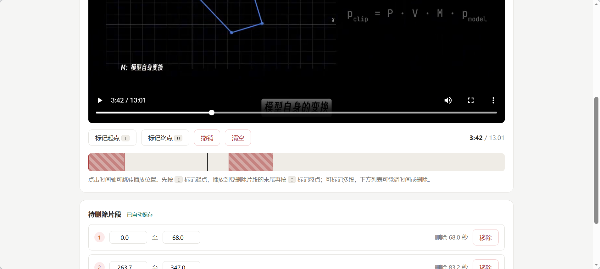
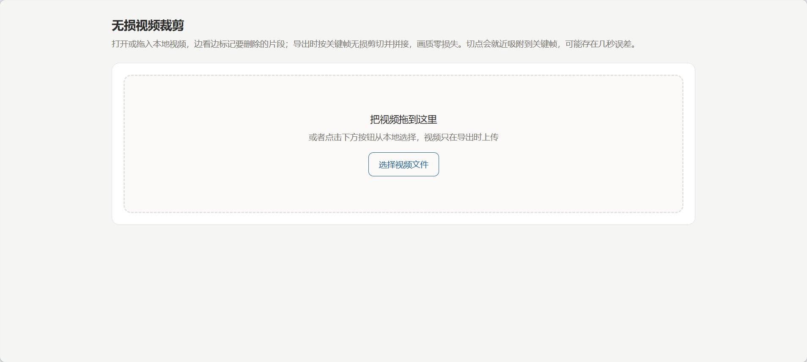

# video-cutter


基于FFmpeg的本地无损视频裁剪工具。在浏览器中边看边标记要删除的片段，导出时按关键帧无损剪切并拼接，画质零损失，全程本地处理不上传云端。

## 1 界面预览

打开即用的一页式界面，把标记与预览放在同一屏内完成。



播放器下方是时间轴：红色斜纹区间为待删除片段，可边播放边标记，也可在列表里逐段微调。



视频拖入即可载入，标记进度自动保存在浏览器本地，重新打开同一视频可自动恢复。

## 2 项目简介

这是一款面向本地使用的视频裁剪小工具，由Python标准库提供的HTTP服务与一个单页Web界面组成。用户打开网页加载本地视频，在时间轴上标记需要删除的片段，工具随即调用FFmpeg按关键帧完成无损剪切与拼接，并把结果保存到项目目录。

之所以强调"无损"，是因为整个裁剪过程使用流复制而非重新编码，切点会就近吸附到关键帧，因而可能存在几秒误差，但画面质量完全不损失，处理速度也很快。工具不依赖任何第三方Python库，唯一的外部依赖是FFmpeg。

## 3 功能特性

工具围绕"标记—预览—导出"这条主线设计，核心优势体现在五个方面。

| 优势 | 说明 |
| --- | --- |
| **便捷性** | 浏览器打开即用，无需安装客户端；拖拽导入、快捷键标记、一键导出，三步完成裁剪。 |
| **本地化** | 视频全程留在本机，仅在导出时上传到本地服务，不经过任何第三方服务器，隐私零外泄。 |
| **轻量化** | 后端仅用Python标准库，零第三方包；前端单页HTML，程序体积小、启动快，老旧设备也能流畅运行。 |
| **可视化** | 边播放边在时间轴标记，红色斜纹实时标示待删除区间，片段列表可逐段微调，所见即所得。 |
| **无损化** | 基于FFmpeg流复制，按关键帧剪切拼接，不重新编码，画质零损失，处理速度接近文件拷贝。 |

此外还提供实时日志推送、自动保存标记与音轨校验等细节，兼顾轻量与可靠，便于二次开发。

## 4 快速开始

### 4.1 环境要求

运行前需准备Python3.11及以上版本（代码使用标准库`tomllib`）与FFmpeg可执行程序，并将FFmpeg加入系统PATH。

### 4.2 安装FFmpeg

从FFmpeg官网下载对应平台的构建包，解压后把`bin`目录加入系统PATH，在命令行执行下面的命令确认安装成功。

```bash
ffmpeg -version
ffprobe -version
```

若能正常输出版本号即可。若FFmpeg不在PATH中，也可在`config.toml`里把`ffmpeg_bin`与`ffprobe_bin`改为可执行文件的绝对路径。

### 4.3 启动服务

克隆仓库后进入项目目录，Windows用户可直接双击`start.bat`，或在命令行执行下面的命令。

```bash
python main.py
```

服务默认监听8765端口，启动后会自动打开浏览器；若未自动打开，可手动访问`http://127.0.0.1:8765`。关闭服务在终端按`Ctrl+C`即可。

## 5 使用方法

打开页面后，把视频拖入虚线区域或点击按钮选择文件，视频随即加载到播放器中。边播放边按`I`标记删除片段的起点，到达片段末尾时按`O`标记终点，时间轴上会以红色斜纹显示待删除区间，下方列表可逐段微调起止时间或移除。

标记完成后点击"执行无损裁剪"，页面会实时打印FFmpeg日志并在成功后给出结果文件名与大小。输出文件保存在项目根目录，文件名为"原文件名加`_cut`后缀"，例如`video.mp4`处理为`video_cut.mp4`。

整个过程仅在你本机进行，源视频与中间分段文件都存放在`backup`目录，不会向外发送。

## 6 配置说明

所有可调参数集中在`config.toml`，代码中不硬编码，修改后重启服务即可生效。常用项如下。

| 配置项 | 说明 | 默认值 |
| --- | --- | --- |
| `server.host` | 监听地址 | `0.0.0.0` |
| `server.port` | 服务端口 | `8765` |
| `server.open_browser` | 启动后是否自动打开浏览器 | `true` |
| `ffmpeg.ffmpeg_bin` | FFmpeg路径 | `ffmpeg` |
| `ffmpeg.ffprobe_bin` | FFprobe路径 | `ffprobe` |
| `ffmpeg.log_encoding` | FFmpeg输出解码编码，中文路径乱码时改为`gbk` | `utf-8` |
| `paths.backup_dir` | 源文件与分段等中间产物目录 | `backup` |
| `paths.output_suffix` | 输出文件名后缀 | `_cut` |
| `cut.min_keep_sec` | 过短的保留段直接丢弃，避免空段导致音轨丢失 | `0.5` |

需要局域网内其他设备访问时，把`server.print_host`改为本机局域网IP即可。

## 7 项目结构

项目文件精简，核心逻辑集中在几个Python文件中。

```
video-cutter/
├── main.py          # HTTP服务与接口路由
├── cutter.py        # FFmpeg探测、区间计算与裁剪拼接
├── settings.py      # 配置加载
├── config.toml      # 运行配置
├── web/index.html   # 前端单页界面
├── README.assets/   # 界面预览截图
├── start.bat        # Windows启动脚本
└── requirements.txt # 依赖说明
```

前端负责交互与标记，后端负责计算区间并驱动FFmpeg，二者通过上传与SSE接口通信。

## 8 许可证

本项目基于Apache License 2.0开源，可自由使用、修改与商用，详见[LICENSE](LICENSE)文件。
